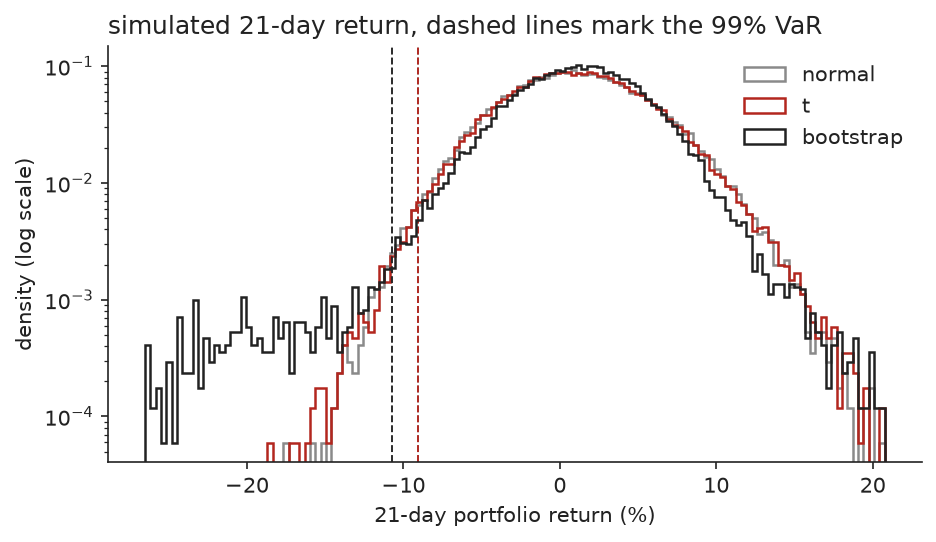
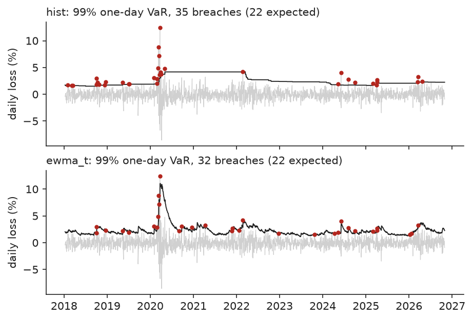

# mc-portfolio-risk

Monte Carlo risk for a stock portfolio. It estimates returns, volatilities and correlations
from daily prices, simulates 50,000 futures of the portfolio under three models, and reads
value at risk (VaR), expected shortfall (ES), drawdowns and per-stock risk contributions off
the simulated distribution. It then checks the models against history with a walk-forward
backtest.

The numbers below are from one run on eight NSE stocks (Reliance, TCS, HDFC Bank, Infosys,
ITC, L&T, Sun Pharma, Maruti), equal weight, daily prices from 2016-01-04 to 2026-10-30,
seed 7. The full output is in [results/report.md](results/report.md).

## Results

21-day horizon, loss as a fraction of the portfolio:

| model | 95% VaR | 95% ES | 99% VaR | 99% ES |
|---|---|---|---|---|
| normal | 6.16% | 7.92% | 9.09% | 10.44% |
| multivariate t (4.89 degrees of freedom) | 6.06% | 7.88% | 9.06% | 10.55% |
| block bootstrap of history | 5.88% | 9.41% | 10.70% | 17.16% |



What the run shows:

- Over 21 days the normal and t models agree to within Monte Carlo error. Both draw each
  day independently, so fat daily tails average out over a month. The bootstrap resamples
  blocks of real days, keeps runs of bad days together, and puts the 99% ES at 17.2%
  instead of 10.5%. The gap comes from volatility clustering, which the first two models
  do not have.
- Scaling the one-day 99% VaR (2.44%) by the square root of time gives 11.19% at 21 days.
  The simulated figure is 9.06%.
- Diversification removes 40.7% of the 99% tail loss: stand-alone ES of the eight holdings
  adds up to 17.79%, the portfolio ES is 10.55%. Maruti, Reliance and L&T each carry about
  14% of the tail on a 12.5% weight, ITC carries 10.7%.
- With the covariance of the worst 63 days in the sample (2020-02-25 to 2020-06-01) the
  99% ES is 31.2%, 2.96 times the baseline. Volatility times 1.5 gives 1.48 times,
  correlations moved halfway to 1 give 1.40 times.
- Expected returns are estimated with a standard error of 7 to 8 points a year, so the
  drift is the weakest input. Setting it to zero moves the 99% ES from 10.55% to 11.32%.
- 20,000 paths put the 95% Monte Carlo band on the 99% ES at about plus or minus 0.3
  points, 50,000 at about 0.2 (figure in the report).

### Backtest

One-day forecasts for 2,174 days (2018-01-10 to 2026-10-30), each made from earlier data
only. At 99% a correct model is breached 21.7 times.

| model | 99% breaches | Kupiec p | Christoffersen p | ES Z2 |
|---|---|---|---|---|
| historical simulation, 500 days | 35 | 0.009 | 0.019 | -0.74 |
| normal, rolling covariance | 39 | 0.001 | 0.036 | -1.48 |
| t, rolling covariance | 28 | 0.196 | 0.052 | -0.64 |
| normal, EWMA covariance | 39 | 0.001 | 0.194 | -1.08 |
| t, EWMA covariance | 32 | 0.039 | 0.090 | -0.53 |

The normal models fail the breach count at 99% with either covariance. The t with a rolling
covariance is the only one that passes both tests, and only just on clustering
(p = 0.052). The EWMA models react to March 2020 within days and their breaches do not
cluster, but the EWMA t still has too many breaches (p = 0.039). Z2 is negative for
every model, so all of them understate ES to some degree, the normal ones by the most.
At 95% all five pass the Kupiec test.



## Method

- Inputs: daily log returns, Ledoit-Wolf shrunk covariance, sample mean as drift (or zero).
- Models: multivariate normal; multivariate t with degrees of freedom fitted by maximum
  likelihood and scaled to the same covariance; stationary block bootstrap of historical
  days with a mean block of 10 days.
- Portfolio: buy and hold from the starting weights, so the loss splits exactly into
  per-stock losses.
- Risk: VaR and ES with bootstrap intervals for Monte Carlo error, maximum drawdown inside
  the horizon, Euler ES contributions (mean loss of each stock over the tail paths),
  stand-alone ES, stress scenarios, and a comparison of equal, inverse volatility and risk
  parity weights.
- Backtest: Kupiec unconditional coverage test, Christoffersen independence test and the
  Acerbi-Szekely Z2 statistic for ES.

## Run it

```
uv venv && uv pip install -e ".[dev]"
.venv/bin/python -m mcrisk portfolio.toml     # writes results/report.md and figures
.venv/bin/python -m pytest
```

Edit `portfolio.toml` to change the tickers (any Yahoo Finance symbol), weights, dates,
horizon, path count or confidence levels. Prices are downloaded once with yfinance and
cached in `data/`. The full run takes about 20 seconds on a laptop.

## Tests

17 tests on synthetic data, no network needed. They check VaR and ES against the normal
closed form, single-asset VaR against the lognormal formula, that simulated covariances
match the input for both models, that ES contributions add up to portfolio ES, the Kupiec
statistic against a known value, and that the backtest never uses future data (changing
later returns leaves earlier forecasts unchanged).

## Limits

- The normal and t models have constant volatility. The backtest shows what that costs.
- The intervals cover Monte Carlo error only, not error in the estimated inputs.
- Yahoo Finance prices are adjusted for splits and dividends but are not audited.
- No transaction costs, no rebalancing inside the horizon, long-only stocks.

## References

- Ledoit and Wolf (2004), A well-conditioned estimator for large-dimensional covariance matrices.
- Politis and Romano (1994), The stationary bootstrap.
- Kupiec (1995), Techniques for verifying the accuracy of risk measurement models.
- Christoffersen (1998), Evaluating interval forecasts.
- Acerbi and Szekely (2014), Backtesting expected shortfall.
