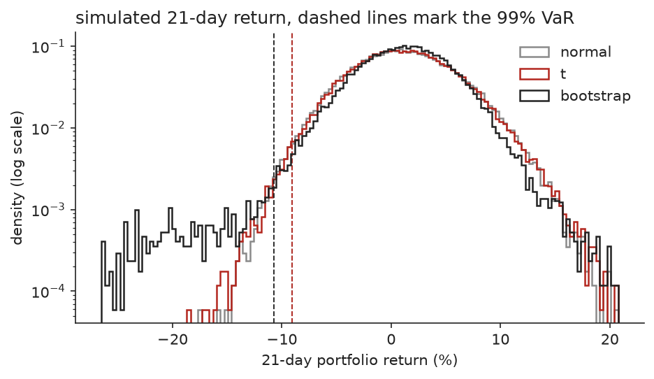
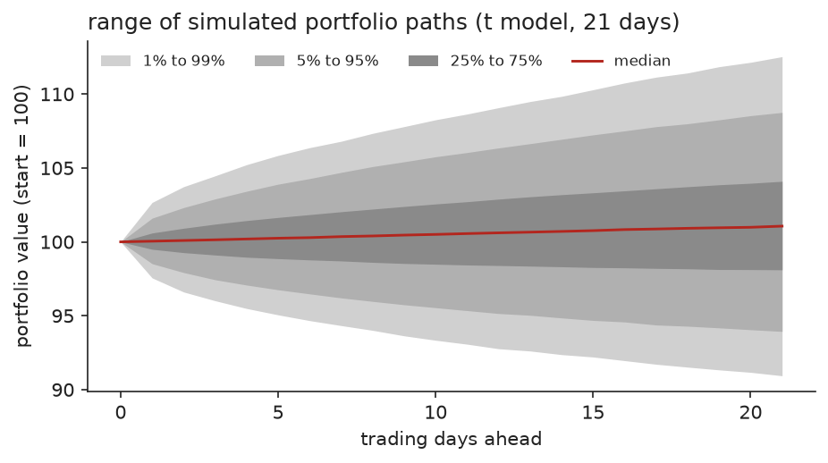
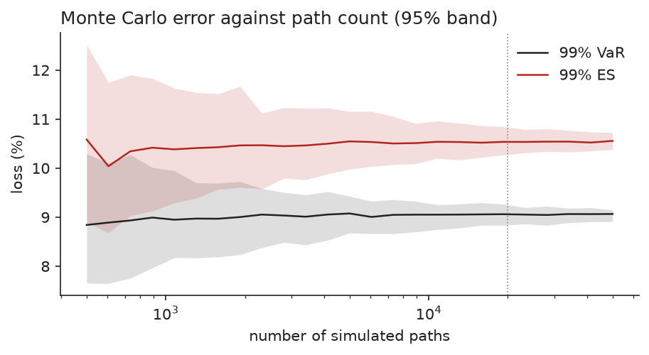
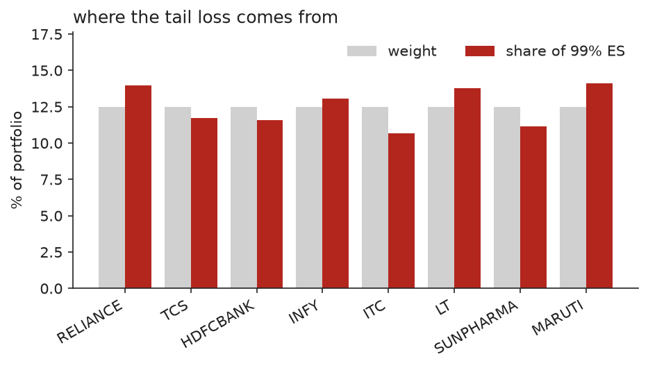
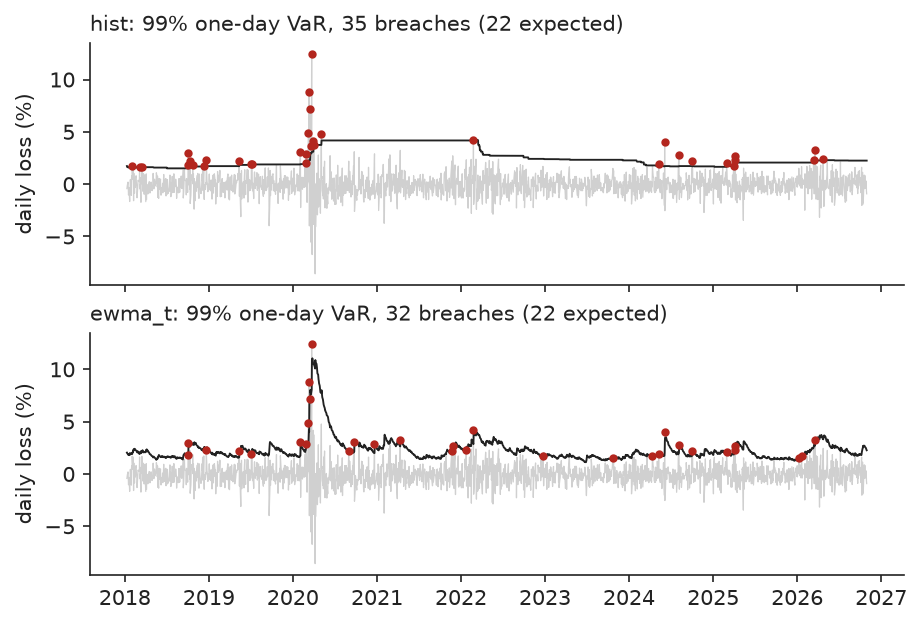

# Portfolio risk report

8 stocks, 2016-01-04 to 2026-10-30 (2674 trading days). 50,000 simulated paths per model, 21-day horizon, buy and hold, drift = historical, seed 7. Losses are fractions of the starting portfolio value.

## Inputs estimated from history

| stock | weight | return / yr | std error | vol / yr | skew | excess kurtosis | worst day |
|---|---|---|---|---|---|---|---|
| RELIANCE.NS | 12.5% | 15.8% | 8.2% | 26.7% | 0.13 | 8.8 | -13.2% |
| TCS.NS | 12.5% | 9.3% | 7.5% | 24.3% | -0.07 | 3.9 | -9.4% |
| HDFCBANK.NS | 12.5% | 9.7% | 6.9% | 22.6% | -0.32 | 10.2 | -12.6% |
| INFY.NS | 12.5% | 9.9% | 8.3% | 27.0% | -0.60 | 9.1 | -16.2% |
| ITC.NS | 12.5% | 5.8% | 7.4% | 24.1% | -0.55 | 10.8 | -12.5% |
| LT.NS | 12.5% | 15.7% | 8.2% | 26.6% | -0.20 | 10.5 | -16.3% |
| SUNPHARMA.NS | 12.5% | 8.2% | 8.3% | 27.1% | -0.14 | 5.2 | -11.5% |
| MARUTI.NS | 12.5% | 9.4% | 8.4% | 27.5% | -0.11 | 10.5 | -16.9% |

Portfolio volatility 15.6% a year. Pairwise correlations run from 0.17 to 0.61, mean 0.28. Ledoit-Wolf shrinkage weight 0.0248. Fitted multivariate t degrees of freedom: 4.89.

Correlation matrix:

|  | RELIANCE | TCS | HDFCBANK | INFY | ITC | LT | SUNPHARMA | MARUTI |
|---|---|---|---|---|---|---|---|---|
| RELIANCE | 1.00 | 0.25 | 0.37 | 0.24 | 0.25 | 0.36 | 0.25 | 0.36 |
| TCS | 0.25 | 1.00 | 0.23 | 0.61 | 0.18 | 0.23 | 0.17 | 0.21 |
| HDFCBANK | 0.37 | 0.23 | 1.00 | 0.26 | 0.28 | 0.45 | 0.18 | 0.38 |
| INFY | 0.24 | 0.61 | 0.26 | 1.00 | 0.17 | 0.25 | 0.19 | 0.18 |
| ITC | 0.25 | 0.18 | 0.28 | 0.17 | 1.00 | 0.31 | 0.20 | 0.26 |
| LT | 0.36 | 0.23 | 0.45 | 0.25 | 0.31 | 1.00 | 0.24 | 0.42 |
| SUNPHARMA | 0.25 | 0.17 | 0.18 | 0.19 | 0.20 | 0.24 | 1.00 | 0.22 |
| MARUTI | 0.36 | 0.21 | 0.38 | 0.18 | 0.26 | 0.42 | 0.22 | 1.00 |

## 21-day VaR and expected shortfall

| model | level | VaR | VaR 95% CI | ES | ES 95% CI |
|---|---|---|---|---|---|
| normal | 95% | 6.16% | 6.08% to 6.25% | 7.92% | 7.82% to 8.01% |
| normal | 99% | 9.09% | 8.91% to 9.24% | 10.44% | 10.28% to 10.60% |
| t | 95% | 6.06% | 5.98% to 6.13% | 7.88% | 7.77% to 7.96% |
| t | 99% | 9.06% | 8.91% to 9.16% | 10.55% | 10.36% to 10.75% |
| bootstrap | 95% | 5.88% | 5.78% to 5.96% | 9.41% | 9.21% to 9.65% |
| bootstrap | 99% | 10.70% | 10.36% to 11.18% | 17.16% | 16.53% to 17.91% |

The intervals are bootstrap intervals for Monte Carlo error only. They say nothing about error in the estimated inputs.

## Shape of the loss distribution (t model)

| measure | value |
|---|---|
| probability of any loss at the horizon | 40.7% |
| probability of losing more than 5% | 8.2% |
| probability of losing more than 10% | 0.51% |
| median return | 1.06% |
| worst simulated path | -18.5% |
| median max drawdown inside the horizon | 3.40% |
| 95th percentile max drawdown | 7.91% |
| 99th percentile max drawdown | 10.45% |

## Horizon scaling (t model)

| days | 99% VaR | 99% ES | 1-day VaR x sqrt(days) |
|---|---|---|---|
| 1 | 2.44% | 3.25% | 2.44% |
| 5 | 4.94% | 6.06% | 5.46% |
| 10 | 6.66% | 7.91% | 7.72% |
| 21 | 9.06% | 10.55% | 11.19% |

## Where the 99% ES comes from (t model)

| stock | weight | ES contribution | share of ES | stand-alone ES |
|---|---|---|---|---|
| RELIANCE.NS | 12.5% | 1.47% | 14.0% | 2.27% |
| TCS.NS | 12.5% | 1.24% | 11.7% | 2.12% |
| HDFCBANK.NS | 12.5% | 1.22% | 11.6% | 1.94% |
| INFY.NS | 12.5% | 1.38% | 13.0% | 2.35% |
| ITC.NS | 12.5% | 1.12% | 10.7% | 2.15% |
| LT.NS | 12.5% | 1.45% | 13.8% | 2.24% |
| SUNPHARMA.NS | 12.5% | 1.18% | 11.1% | 2.35% |
| MARUTI.NS | 12.5% | 1.49% | 14.1% | 2.37% |

Contributions add up to the portfolio ES of 10.55%. The stand-alone figures add up to 17.79%, so diversification removes 40.7% of the tail loss.

## Stress scenarios (t model)

| scenario | 99% VaR | 99% ES | ES vs baseline |
|---|---|---|---|
| baseline | 9.06% | 10.55% | 1.00x |
| volatility x 1.5 | 13.54% | 15.62% | 1.48x |
| correlations halfway to 1 | 12.50% | 14.76% | 1.40x |
| covariance of 2020-02-25 to 2020-06-01 | 26.96% | 31.18% | 2.96x |
| zero drift | 9.85% | 11.32% | 1.07x |

The covariance scenario uses the 63 days in the sample where the portfolio was most volatile.

## Other ways to weight the same stocks (t model)

| scheme | vol / yr | 99% VaR | 99% ES | largest weight | smallest weight |
|---|---|---|---|---|---|
| configured | 15.6% | 9.06% | 10.55% | 12.5% | 12.5% |
| inverse_vol | 15.5% | 9.01% | 10.50% | 14.1% | 11.7% |
| risk_parity | 15.4% | 8.96% | 10.46% | 14.3% | 10.9% |

## Backtest of one-day forecasts

Walk forward over 2174 days (2018-01-10 to 2026-10-30). Each forecast uses only earlier data. A breach is a day whose loss exceeded the VaR forecast. Kupiec tests the breach count, Christoffersen tests whether breaches cluster; p below 0.05 rejects the model. Z2 is the Acerbi-Szekely ES statistic: about 0 when ES is right, negative when ES is too small.

| model | level | breaches | expected | Kupiec p | Christoffersen p | ES Z2 |
|---|---|---|---|---|---|---|
| hist | 95% | 122 | 108.7 | 0.199 | 0.119 | -0.20 |
| hist | 99% | 35 | 21.7 | 0.009 | 0.019 | -0.74 |
| normal | 95% | 110 | 108.7 | 0.898 | 0.072 | -0.26 |
| normal | 99% | 39 | 21.7 | 0.001 | 0.036 | -1.48 |
| t | 95% | 121 | 108.7 | 0.234 | 0.107 | -0.24 |
| t | 99% | 28 | 21.7 | 0.196 | 0.052 | -0.64 |
| ewma | 95% | 120 | 108.7 | 0.274 | 0.794 | -0.24 |
| ewma | 99% | 39 | 21.7 | 0.001 | 0.194 | -1.08 |
| ewma_t | 95% | 125 | 108.7 | 0.117 | 0.629 | -0.20 |
| ewma_t | 99% | 32 | 21.7 | 0.039 | 0.090 | -0.53 |

